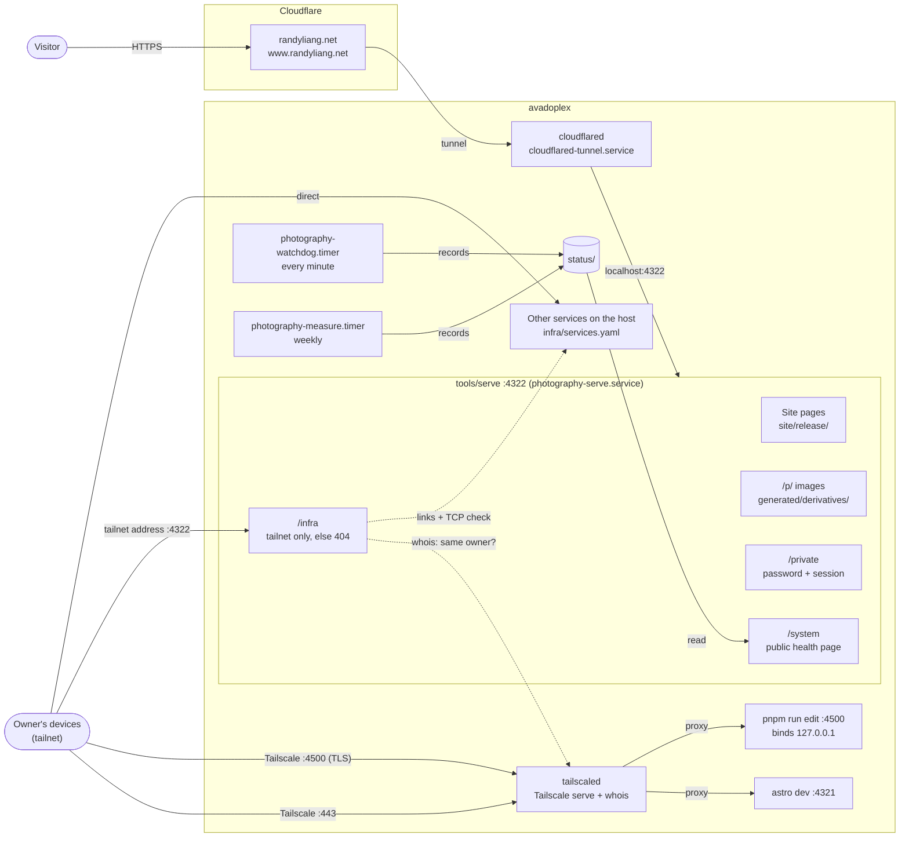
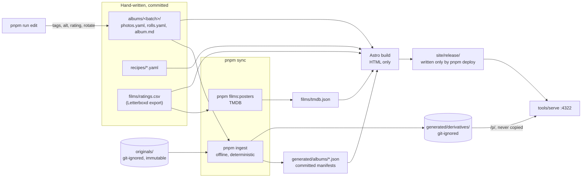

# Architecture

Two diagrams: how a request reaches avadoplex (this host), and how content
becomes the site. The prose is elsewhere: `CLAUDE.md` (the photography
pipeline), `docs/deployment.md` (keeping it up), `docs/decisions.md` (why).

## Requests: the public path and the tailnet

Everything public enters through the Cloudflare tunnel, which connects from
loopback, so it can only ever reach `:4322`. Everything else is reachable
only over Tailscale. The ports of the host's other services, the ones listed on
`/infra`, are kept in git-ignored `infra/services.yaml` and are not in this
repo.

`/infra` decides access from the connection alone: it has to arrive on this
host's Tailscale address, from a Tailscale address that tailscaled's `whois`
names as the owner's device (or a device the tailnet policy has granted
`randyliang.net/cap/infra`). Loopback, including the tunnel, always gets
the ordinary 404.

## Content: from disk to the live release

`pnpm deploy` runs that whole right-hand path: verify, sync, build into
`site/release.next/`, prove it on `:4398`, then swap it in. See
`docs/deployment.md`.

## Why this shape

Each choice is the simplest thing that holds for a one-person archive served
from one home machine. The dated reasoning, including the alternatives that
were rejected, is in `docs/decisions.md`. This is the summary.

| Choice                                                             | Why it's the right trade here                                                                                                                                                                                                                                              | Rejected                                                                                                                                                                                             | Decision                |
| ------------------------------------------------------------------ | -------------------------------------------------------------------------------------------------------------------------------------------------------------------------------------------------------------------------------------------------------------------------- | ---------------------------------------------------------------------------------------------------------------------------------------------------------------------------------------------------- | ----------------------- |
| **Static Astro site, plus a small server in front of it**          | Every public page is plain HTML, so it can't break at request time and works with JavaScript disabled. The few things that need a server (the `/private` password, `/p/` images, `/system`, `/infra`) live in `tools/serve`, so the build never has to know about privacy. | An Astro server adapter with per-route `prerender` flags: "this page is static" would become something you have to remember on every file.                                                           | 2026-08-08              |
| **An offline pipeline, with a committed manifest as the contract** | `pnpm ingest` is deterministic and never touches the network. The site reads JSON, never photographs, so either side can change without touching the other. ESLint enforces that the pipeline never imports the site's framework.                                          | Sharing runtime schema objects across the boundary; a build step for `tools/`.                                                                                                                       | 2026-07-28              |
| **One flat archive; trips are tags**                               | One code path for trips, places and subjects. A photo can belong to any number of views without being copied.                                                                                                                                                              | A structural "album" or "trip" type that owns photographs.                                                                                                                                           | 2026-07-29              |
| **Images served from where ingest writes them**                    | One copy of ~6 GB instead of three. Builds take seconds, and the live site stays up during a deploy.                                                                                                                                                                       | Copying into `site/public/` and `dist/`; R2 (extra credentials and a second place images live; still the next step if bandwidth ever matters).                                                       | 2026-10-24              |
| **systemd units, committed under `deploy/`**                       | The site comes back on its own after a reboot or crash. How the box is configured is in `git log`, not in someone's memory.                                                                                                                                                | A hand-started `pnpm serve`; Docker or a reverse proxy (systemd already supervises both processes).                                                                                                  | 2026-08-17, 2026-10-25  |
| **Deploying by running one command on the box**                    | `pnpm deploy` verifies, builds beside the live release, proves the new one on a spare port, swaps it in with two renames, and rolls back on its own if the production check fails. A content deploy has no downtime.                                                       | CI/CD pushing to the box (SSH secrets, a runner to trust, harder to debug); a symlinked `current` release (invariant 5); blue-green with a cloudflared port switch on every deploy.                  | 2026-08-17, 2026-10-25  |
| **Cloudflare Tunnel for public traffic**                           | The tunnel connects outward from the box, so no inbound port is open to the internet. It arrives from loopback and its ingress points only at `:4322`, so nothing else on the host is publicly reachable even by mistake.                                                  | Not written up in `decisions.md`. The obvious alternative, port-forwarding from the router, would expose the home IP and an open port.                                                               | 2026-08-17 (units only) |
| **Tailscale for everything else, `/infra` decided by tailscaled**  | The dev server, the editor and the host's other services are reachable only from the owner's devices. `/infra`'s access check uses the connection's own addresses and tailscaled's `whois`, so the tailnet policy, not this code, decides who gets in.                     | A password (the tailnet already authenticates the device); trusting a header from Tailscale serve (it can be forged through any other path); listing `/infra` in robots.txt (it would advertise it). | 2026-10-26              |
| **`/system` reads recorded files and runs nothing**                | The watchdog and measurement timers write to `status/`; the page only renders allowlisted fields from it. Viewing it can't load the box or leak anything that isn't allowlisted.                                                                                           | None written up. The rule is simply that the page never starts a test, build or measurement.                                                                                                         | 2026-10-26              |

**Revisit when** a second person needs to deploy (one box over SSH stops
being a reasonable model), bandwidth starts to matter (move images to R2), or
uptime needs grow past what systemd restarts plus a same-day manual fix
cover.
